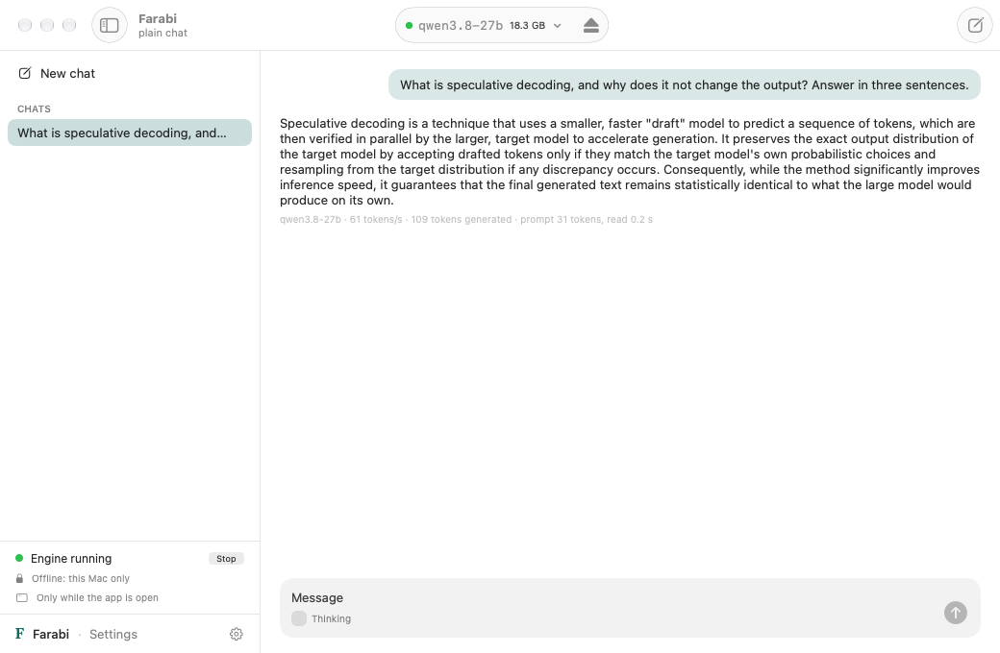

# Farabi

A local LLM inference engine for Apple Silicon, written on top of [MLX](https://github.com/ml-explore/mlx), plus a small macOS chat app.

Farabi runs **Qwen 3.8 27B** and **Gemma 4 31B** (text + images) on a Mac, speaks a subset of the Ollama HTTP API on `127.0.0.1:11438`,
and is built around four ideas:

- **Nothing leaves the machine.** The server re-launches itself inside a macOS sandbox that allows only loopback traffic. If the lock
  is not active, the server refuses to start.
- **Speculative decoding that keeps the output.** Qwen's own multi-token-prediction head, or Google's Gemma assistant drafter, proposes
  the next few tokens; the main model verifies them in one forward pass. A small controller picks the draft depth per round.
- **Prompts are read once.** Every conversation is a session with snapshots; a new chat behind the same system prompt forks from the
  cached prefix instead of re-reading it, and long prefixes are also kept on disk across restarts.
- **Careful 4-bit weights.** The `tools/` folder contains the nvfp4 quantization pipeline used for the published weights:
  power-of-two shifts, least-squares block scales and a GPTQ calibration pass.



> **Status: snapshot release.** This is a one-time release of a working system, published as-is. It was developed and measured on a
> single machine (M5 Max, 40-core GPU, 64 GB, macOS 27). Issues and pull requests may not get an answer. See
> [What was verified](#what-was-verified) and [Known limitations](#known-limitations).

## What is in the repository

| Path | What |
|---|---|
| `engine/` | The engine: model loading, speculative decoding, sessions and caches, chat formatting, JSON-schema constraint, vision, embeddings, HTTP server |
| `tools/` | Quantization / conversion scripts (nvfp4, shift + block-scale fitting, GPTQ, calibration) |
| `tests/` | Four model-less test scripts and one smoke test against a running server |
| `app/` | Farabi.app — a plain SwiftUI chat front-end and background watchdog for the engine |
| `models/` | Model cards for the weight repositories |

## Requirements

- Apple Silicon Mac, macOS 26 or later. 32 GB of memory is the practical minimum for one 4-bit ~30B model; both families at once want 64 GB.
- Python 3.12.
- Verified with released wheels in a fresh virtual environment: `mlx` 0.32.4, `mlx-lm` 0.32.2, `mlx-vlm` 0.7.12, `llguidance` 1.9.1,
  `transformers` 5.23 (these are what `requirements.txt` installs). Development used MLX built from source at commit `54a70511`
  (0.32.5.dev). Your MLX build must provide the `nvfp4` quantization mode.

## Install and run

```bash
git clone https://github.com/maximianuu/farabi ~/farabi && cd ~/farabi
python3.12 -m venv .venv && .venv/bin/pip install -r requirements.txt
```

Download the model folders you need from Hugging Face into `~/.farabi/models` (or point `FARABI_MODELS` somewhere else), for example
`hf download maximianuu/qwen3.8-27b-nvfp4-gptq --local-dir ~/.farabi/models/qwen3.8-27b-nvfp4-gptq`:

| Folder | Hugging Face repository | Contents | Size |
|---|---|---|---|
| `qwen3.8-27b-nvfp4-gptq` | `maximianuu/qwen3.8-27b-nvfp4-gptq` | Qwen 3.8 27B, 4-bit nvfp4 (shift + block scale + GPTQ) | 17 GB |
| `qwen3.8-27b-mtp/mtp.safetensors` | `maximianuu/qwen3.8-27b-mtp` | Qwen's multi-token-prediction head (draft model) | 0.8 GB |
| `gemma-4-31b-it-nvfp4` | `maximianuu/gemma-4-31b-it-nvfp4` | Gemma 4 31B, 4-bit nvfp4 (shift + block scale) | 17 GB |
| `gemma-4-31b-it-assistant-nvfp4` | `maximianuu/gemma-4-31b-it-assistant-nvfp4` | Gemma 4 assistant drafter, 4-bit | 0.3 GB |
| `bge-m3-mlx-fp16` | `mlx-community/bge-m3-mlx-fp16` | bge-m3 embedding model | 1.1 GB |

Only the models you actually request are loaded; you can install just one family. The weights must be the ones produced by `tools/`
(see `models/`): they carry compensation values in `config.json` that other loaders do not apply.

```bash
.venv/bin/python -m engine.server            # listens on 127.0.0.1:11438
curl -s localhost:11438/                     # {"status": "Farabi is running", "network_lock": true, ...}
curl -s localhost:11438/api/chat -d '{"model": "qwen3.8-27b", "stream": false,
  "messages": [{"role": "user", "content": "Say hello."}]}'
```

The server downloads nothing. `HF_HUB_OFFLINE=1` is set at start-up and the sandbox blocks all non-loopback traffic, DNS included.

## HTTP API

A subset of the Ollama API, enough for chat clients that already speak it:

| Endpoint | Notes |
|---|---|
| `POST /api/chat` | streaming or not; `think`, `tools`, `images` (base64), `format` (`"json"` or a JSON Schema), `keep_alive`, `options` |
| `POST /api/embed`, `POST /api/embeddings` | bge-m3 |
| `POST /api/generate` | load / unload only (`keep_alive`); text generation goes through `/api/chat` |
| `GET /api/tags`, `GET /api/ps`, `POST /api/show`, `GET /api/version` | model list, loaded models, model details |
| `GET /` | engine status |

Model names: `qwen3.8-27b` and `gemma4-31b` (a name starting with `gemma` selects the Gemma family; anything else runs Qwen).

Extra request fields (all optional):

| Field | Meaning |
|---|---|
| `"priority": "background"` | Background job (also `"batch"`, `"low"`). It pauses between token rounds when an interactive request arrives, lets that request run, then resumes where it stopped. |
| `"cache": false` | Do not keep this conversation's session (one-shot prompts). |
| `"release_other": true` | The user switched to this model: unload the other family first, unless it is being used in the background. |
| `"client": "app"` | Marks requests from the interactive client; other requests count as background use of a family for `release_other`. |
| `options.draft: false` | Disable speculative decoding for this request (plain decoding). |
| `options.thinking_limit` | Close the thinking block after this many tokens (default 3000). |
| `options.trace: true` | Return a per-round trace of drafted / accepted tokens. |

The final message of a chat response carries an `engine` object: how the session cache was used (`"cache"`: `new`, `fork`, `continued`,
`rewind`, `disk`), prompt tokens actually read (`"read"`), decoding rounds, drafted and accepted tokens, and queue information
(`"priority"`, `"wait_s"`, and for a preempted background job `"interleaved"` and `"paused_s"`).

`GET /` returns `status`, `version`, `loaded`, `gemma_loaded`, `busy`, `queued` (`front` / `normal` / `background`), `preempting`,
`preemptions`, `network_lock`, `model`, `gemma`, `last_external_request_s`, `model_switches` and `effort`.

## Configuration

| Variable | Default | Meaning |
|---|---|---|
| `FARABI_MODELS` | `~/.farabi/models` | Root folder of the model folders above |
| `FARABI_MODEL`, `FARABI_MTP` | under the root | Qwen model folder and MTP head file |
| `FARABI_GEMMA`, `FARABI_GEMMA_DRAFT` | under the root | Gemma model and drafter folders |
| `FARABI_EMBED_MODEL` | under the root | bge-m3 folder |
| `FARABI_PORT` | `11438` | Port (also `--port`); `--preload` loads the Qwen model at start-up |
| `FARABI_LOG` | `~/Library/Logs/farabi-engine.log` | One line per request: cache use, tokens read, speed. Message contents are never logged. |
| `FARABI_NETWORK_LOCK` | on | `off` skips the sandbox (debugging only) |
| `FARABI_PREFIX_CACHE` | `~/.farabi/prefix-cache` | Folder of the on-disk prefix cache; `off` disables it |
| `FARABI_PREFIX_CACHE_MAX` | `16` | Maximum number of prefix files kept on disk (each roughly 1.4-2.4 GB) |
| `FARABI_EFFORT` | `medium` | Thinking effort used when a request says `think: true` |
| `FARABI_SCHEMA_OPEN` | off | `1`: objects with `properties` stay open to extra fields (JSON Schema default). By default they are closed, as in Ollama. |
| `FARABI_BACKGROUND_WINDOW_S` | `180` | A family that served a non-app request this recently counts as "in background use" |
| `FARABI_GEMMA_PERSIST`, `FARABI_QWEN_PERSIST` | on | `0`: do not keep the tokenizer / image processor in the process after unloading |
| `FARABI_GEMMA_PERSIST_S` | `1800` | How long they are kept after the model is unloaded |
| `FARABI_GEMMA_IMAGE_BUDGET` | by image area | Fixed number of soft tokens per image for Gemma (280 / 560 / 1120) |
| `FARABI_GEMMA_FAST_ATTENTION` | on | `0` disables the grouped full-attention path |

If an Ollama server is running on the same Mac, the engine asks it (`127.0.0.1:11434/api/ps`) how much memory its loaded models hold and
budgets GPU memory around them. Nothing else is shared with Ollama; neither its code nor its model files are used.

## How it works (short)

- **`engine/core.py`, `engine/session.py` — Qwen.** The MTP head drafts tokens, the main model verifies them in one pass, the accepted
  prefix is kept and the caches are rolled back for the rest. Linear-attention layers carry recurrent state that cannot be rewound, so
  sessions take snapshots at the places a conversation can branch from: the end of the system block, sparse checkpoints inside long
  system prompts, and the start of the last generation.
- **`engine/gemma.py` — Gemma 4.** Same idea with Google's assistant drafter. The snapshot is the sliding-attention window itself;
  full-attention caches are rewound by length. Images get 280 / 560 / 1120 soft tokens depending on their pixel area.
- **`engine/depth.py`.** Chooses how many draft tokens to try per round from measured cost and acceptance.
- **`engine/constraint.py`.** JSON Schema via [llguidance](https://github.com/guidance-ai/llguidance), applied to the verification rows so
  constrained output still decodes speculatively. Tokens forced by the schema are emitted without spending a draft round.
- **`engine/disk.py`.** Long prefixes seen at least twice are written to disk at checkpoint positions and restored after a restart.
- **`engine/server.py`.** One worker thread owns the models (MLX streams are thread-bound). The queue has three priorities; background
  chat jobs are preempted between token rounds. Session-pool budgets are computed from the GPU memory limit, the loaded families and
  what Ollama holds.
- **`engine/vision.py`, `engine/embedding.py`.** Image input for Qwen (vision tower and preprocessing from `mlx-vlm`) and bge-m3 embeddings.

## Measurements

Numbers from the development machine, temperature 0 unless noted; treat them as an indication, not a benchmark.

| | Plain decoding | With draft model |
|---|---|---|
| Qwen 3.8 27B, 4-bit | 32 tokens/s | 55-58 tokens/s |
| Gemma 4 31B, 4-bit | 26-28 tokens/s | 52-77 tokens/s (prose to code) |

Fidelity of the published Qwen weights to the original bf16 model (KL divergence / agreement of the top token, 8,087 positions):
`0.085 / 93.5%`; the stock MLX `nvfp4` conversion of the same model measured `0.339 / 82.4%`. The reason is described in
`tools/nvfp4.py`: without a global scale, per-block scales fall into the subnormal range of the 8-bit scale format.

## What was verified

Before this release, with the released wheels listed above and the published weights:

- `tests/server_smoke.py` against a running server with the Qwen model: 15 of 15 checks (streaming, cache continuation and fork,
  thinking, tool calls, JSON Schema, image input, speed, cancellation).
- The four model-less test scripts: 36/36, 22/22, 59/59 and 28/28.
- The on-disk prefix cache: a 3,837-token prompt was read once, forked chats read 22-23 tokens, and after a server restart the same
  prefix was restored from disk (21 tokens read).
- Farabi.app: built with ad-hoc signing, the headless `--test-chat` mode and a windowed chat (the screenshot above) against the engine.
- The network lock: the server reports `"network_lock": true` and refuses to start without it.

Not verified: other Macs, other macOS versions, smaller memory sizes.

## Tests

```bash
.venv/bin/python tests/queue_test.py .      # priority queue and preemption        (no model, standard library only)
.venv/bin/python tests/pool_test.py .       # session pools with paused jobs       (no model, needs mlx)
.venv/bin/python tests/memory_test.py .     # checkpoint placement, pool budgets   (no model)
.venv/bin/python tests/switch_test.py .     # unloading the other family           (no model)
.venv/bin/python tests/server_smoke.py      # against a running server with the Qwen model
```

## Quantization tools

```bash
python tools/convert.py   <original Qwen folder> <base MLX folder>              # layout + plain nvfp4 (embeddings, gate projections kept bf16)
python tools/convert3.py  <original> <base MLX folder> <out>                    # power-of-two shifts + least-squares block scales
python tools/convert4.py  <original> <base MLX folder> <out>                    # + GPTQ, layer by layer on calibration text
python tools/gemma_convert3.py <original Gemma folder> <base MLX folder> <out>  # Gemma: shifts + block scales
python tools/gemma_embed.py    <previous output> <out>                          # Gemma: 4-bit embedding table
python tools/gemma_draft.py    <original assistant folder> <out>                # Gemma drafter, 4-bit
```

Calibration text comes from `tools/calibration.py`; see `tools/calibration_data/README.md` for how to add your own.

## The app

`app/` is a small SwiftUI app: a model picker with load / unload and a memory indicator, saved chats, English or Turkish UI, and a
switch that keeps the engine running in the background through a launchd watchdog. It sends only your messages (no system prompt, no
tools). Build instructions are in `app/README.md`.

## Known limitations

- Two model families are wired in by name; adding another needs code, not configuration.
- No video input. `/api/generate` does not generate text.
- The model-less tests cover queueing and memory logic; decoding itself is only covered by the smoke test, which needs the weights.
- Verified on one Mac only (see above).

## License

The code in this repository is released under the [MIT License](LICENSE). It depends on MLX, mlx-lm, mlx-vlm and llguidance (MIT),
transformers, tokenizers and safetensors (Apache 2.0); see [THIRD-PARTY.md](THIRD-PARTY.md).

Model weights are separate works with their own licenses: Qwen 3.8 27B and Gemma 4 31B are Apache 2.0, bge-m3 is MIT. "Qwen" and "Gemma"
are names of their respective owners; this project is not affiliated with or endorsed by them, nor by Ollama.
